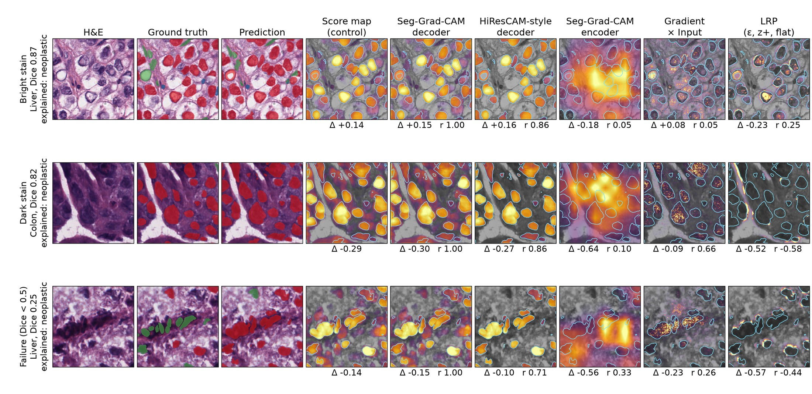
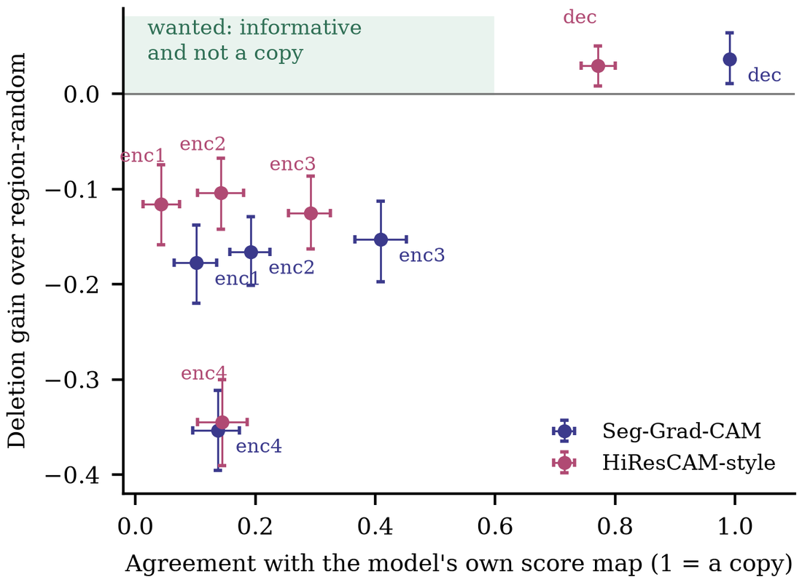

# Heatmaps That Redraw the Prediction: A Control-Based Audit of Attribution Maps for Nucleus Segmentation in Histopathology

**Devi Sri Bandaru** and **Deepshikha Bhati**  
*Department of Computer Science, Kent State University, Kent, OH, USA*

[](https://www.python.org/downloads/)
[](https://pytorch.org/)
[](checkpoints/)
[](results/pannuke_resnet50/xai_audit/explorer.html)
[](https://huggingface.co/spaces/Devisri515/medseg-rai)
[](LICENSE)

---

This repository contains the complete implementation, trained model checkpoints, per-image audit data, reproduction scripts, and interactive visual analytics explorer for the paper:

> **Heatmaps That Redraw the Prediction: A Control-Based Audit of Attribution Maps for Nucleus Segmentation in Histopathology**  
> Devi Sri Bandaru and Deepshikha Bhati (Kent State University, 2026)  
> *Preprint / Code Repository:* [`https://github.com/Devisri-B/MedSeg-Explainable-Equitable-Medical-Segmentation-Pipeline`](https://github.com/Devisri-B/MedSeg-Explainable-Equitable-Medical-Segmentation-Pipeline)

The repository also includes **MedSeg-RAI**, the full multi-class histopathology segmentation pipeline on which the audit was developed—featuring U-Net/U-Net++/FPN training, uncertainty quantification, subgroup fairness auditing across 19 tissues, drift monitoring, and clinical governance tooling.

---



*Figure 1 from the paper: Attribution maps from Model A (U-Net++ / ResNet-50) for a bright-stain tile (top), a dark-stain tile (middle), and a segmentation failure case (bottom, Dice < 0.5). For each map: **Δ** denotes deletion gain over random pixels inside the explained nucleus region (positive = informative; negative = worse than random chance), and **r** denotes Spearman rank correlation with the model's raw class-score control map (1.00 = identical copy). Cyan contours outline the explained nucleus region. Maps are clipped at their 99th percentile for display. Decoder Seg-Grad-CAM acts as a near-perfect copy of the prediction score ($r = 1.00$), including on the failure case where it highlights misclassified nuclei with high confidence and gives no sign that the segmentation is incorrect.*

---

## Abstract & Research Questions

Attribution heatmaps are widely used to interpret deep learning-based medical image segmentation, yet their visual plausibility does not guarantee that they faithfully represent model decisions. In clinical workflows, heatmaps placed beside segmentations invite a simple reading: *the bright pixels are the reason the model drew what it drew.* Yet segmentation heatmaps are almost always evaluated purely by eye.

This study asks three quantitative questions:
1. **Does the attribution map reflect what the network computed, or does it simply redraw the predicted mask?**
2. **Is explanation quality uniform across tissue types and staining conditions, given that segmentation accuracy already differs across them?**
3. **Can explanation quality warn clinicians when a segmentation has failed?**

To answer these questions, we introduce a deliberately plain yardstick: a **gradient-free control baseline** derived directly from the network's own class-score map ($\text{ReLU}(\text{logit}_c)$ inside the predicted region). If an attribution map requiring gradients and backward passes performs no better at ranking pixels than this gradient-free score map, it is merely copying the prediction—however convincing it looks.

Across **3,180 image-level evaluations** spanning three segmentation architectures, four held-out folds, and two independent histopathology datasets (PanNuke and external MoNuSeg), we audit six attribution configurations against this control.

---

## Experimental Setup: The Four Studies

We evaluate four distinct experimental studies to ensure findings are not quirks of an isolated model or split:

| Study | Model Architecture | Evaluation Cohort | Audited Images | Explained Class Mean Dice |
|:---:|:---|:---|:---:|:---:|
| **A** | **U-Net++ / ResNet-50** (Tuned main model) | PanNuke fold 3 (19 tissue types) | 659 | 0.72 |
| **B** | **FPN / ResNet-18** (Trained for 3 epochs) | PanNuke fold 1 (19 tissue types) | 1,333 | 0.59 |
| **C** | **Model A applied to external data** | MoNuSeg (external institutions) | 200 | 0.82 |
| **D** | **U-Net / ResNet-18** (Trained for 4 epochs) | PanNuke fold 2 (19 tissue types) | 988 | 0.61 |
| **Total** | | | **3,180** | |

*In Study C, because MoNuSeg lacks multi-class nucleus types, the five nucleus logits are merged via log-sum-exp into a single foreground score ([`medseg/explain/binary_fg.py`](medseg/explain/binary_fg.py)).*

### Evaluated Attribution Configurations

| Method Code | Description | Layer Target |
|:---|:---|:---|
| `cam@dec` | **Seg-Grad-CAM** | Final decoder block |
| `hires@dec` | **HiResCAM-style** (element-wise gradient $\times$ feature map, no spatial pooling) | Final decoder block |
| `cam@enc4` | **Seg-Grad-CAM** | Deepest encoder stage (Stage 4) |
| `hires@enc4` | **HiResCAM-style** | Deepest encoder stage (Stage 4) |
| `gxi` | **Gradient × Input** | Input pixel space |
| `lrp` | **Layer-wise Relevance Propagation** (Zennit; $\epsilon$ dense, $z^+$ conv, flat input layer) | Full model decomposition |
| `logit` | **Prediction Score Control** ($\text{ReLU}$ of target class logit; requires **no gradients**) | Output layer |

---

## Key Findings

### 1. Decoder-Level Maps Redraw the Prediction ($r = 0.95 - 0.99$)
Decoder Seg-Grad-CAM correlates $0.95$ to $0.99$ with the gradient-free score control in every study (A: $0.991$, B: $0.977$, C: $0.946$, D: $0.963$), and its deletion gain differs from the control's by at most $0.013$. Because the final decoder block feeds directly into a $1 \times 1$ convolutional segmentation head, spatial gradients inside the nucleus region are nearly constant; channel weights provide virtually zero spatial information beyond the predicted class score itself.

### 2. Looking Deeper Does Not Help ($\Delta = -0.06 \text{ to } -0.38$)
Encoder-level attribution maps (CAM and HiResCAM at Stage 4) and LRP rank pixels **worse than random chance** inside the explained region across all four studies ($\Delta$ between $-0.06$ and $-0.38$). Even though encoder maps and LRP appear visually localized (localization enrichment $3.3\times$ to $4.0\times$), pixel-deletion reveals their ranking inside the region is worse than random selection. An encoder depth sweep across all stages (Figure 2) reveals no intermediate layer that is both faithful and not a copy. Furthermore, an LRP ablation across three distinct propagation rules confirms this negative deletion gain is invariant to the choice of LRP rule.

### 3. Explanation Stability Masks a Stain Effect ($p < 10^{-20}$)
Decoder maps appear significantly more stable under stain jitter in dark-stained images across every study (pooled probability that a dark image is more stable than a bright one: $0.73$ over 179 dark images, $p < 10^{-20}$), while segmentation Dice shows no consistent difference (pooled $0.52, p = 0.32$). Because stable maps also copy the prediction more closely, we adjusted for agreement with the control; the dark-stain stability gap survives adjustment in three of four studies (+0.045, +0.078, +0.090, +0.020).

### 4. Failure Detection is Model-Dependent
Can explanation signals warn clinicians when a segmentation is wrong ($\text{Dice} < 0.5$)? On the tuned model (Study A), adding explanation features to predictive uncertainty adds nothing to failure detection ($\text{AUROC } 0.872 \to 0.862, \Delta = -0.010$). On weaker models (B and D), explanation metrics offer modest improvements ($+0.034$ and $+0.014$ AUROC). Explanation quality cannot be assumed to reliably signal segmentation failure.

---

## Quantitative Results (Paper Tables & Figures)

### Table 2: Deletion Gain Over Region-Random Pixels
Mean deletion gain $\Delta$ over random pixels inside the explained region (with 95% bootstrap confidence intervals). Values above 0 indicate the map ranks pixels better than chance; the control is the network's own class-score map.

| Attribution Map | Study A ($n = 659$) | Study B ($n = 1,333$) | Study C ($n = 200$) | Study D ($n = 988$) |
|:---|:---:|:---:|:---:|:---:|
| **Score map (Control)** | **0.023** (0.012, 0.035) | **−0.045** (−0.053, −0.036) | **−0.015** (−0.038, 0.008) | **−0.009** (−0.017, −0.001) |
| **Seg-Grad-CAM, decoder** | 0.021 (0.010, 0.033) | −0.043 (−0.051, −0.034) | −0.025 (−0.049, −0.002) | −0.022 (−0.030, −0.015) |
| **HiResCAM-style, decoder** | 0.018 (0.008, 0.029) | −0.035 (−0.043, −0.028) | −0.015 (−0.038, 0.007) | 0.010 (0.004, 0.017) |
| **Seg-Grad-CAM, encoder** | −0.366 (−0.384, −0.349) | −0.115 (−0.127, −0.103) | −0.296 (−0.329, −0.263) | −0.147 (−0.162, −0.133) |
| **HiResCAM-style, encoder** | −0.355 (−0.372, −0.337) | −0.077 (−0.088, −0.066) | −0.304 (−0.337, −0.272) | −0.055 (−0.069, −0.041) |
| **Gradient × Input** | −0.109 (−0.123, −0.095) | 0.016 (0.005, 0.026) | −0.154 (−0.175, −0.131) | 0.025 (0.015, 0.034) |
| **LRP ($\epsilon, z^+, \text{flat}$)** | −0.309 (−0.330, −0.288) | −0.221 (−0.234, −0.207) | −0.375 (−0.411, −0.340) | −0.172 (−0.186, −0.158) |
| **Decoder CAM vs Control ($r$)** | **0.991** | **0.977** | **0.946** | **0.963** |

---

### Table 3: Failure Detection and Stain Stability

| Metric | Study A | Study B | Study C | Study D |
|:---|:---:|:---:|:---:|:---:|
| **Segmentation Failures (Dice < 0.5)** | 75 / 659 | 330 / 1,333 | 0 / 200 | 214 / 988 |
| **Predictive Uncertainty AUROC** | 0.872 | 0.780 | — | 0.849 |
| **+ Explanation Signals (Δ AUROC)** | **−0.010** (−0.039, 0.015) | **+0.034** (0.012, 0.057) | — | **+0.014** (0.001, 0.028) |
| **Dark Effect, raw** | +0.081 | +0.083 | +0.079 | +0.056 |
| **Dark Effect, adjusted for copying** | **+0.045** (0.013, 0.078) | **+0.078** (0.061, 0.092) | **+0.090** (0.036, 0.162) | +0.020 (−0.029, 0.067) |

*Bold intervals exclude 0. In Study C, zero tiles fell below Dice 0.5, precluding failure classification.*

---

### Figure 2: Encoder Depth Sweep

<p align="center">
  
</p>

*Depth sweep on Model A (100 images, 95% bootstrap intervals): Every encoder stage ranks pixels worse than random chance ($\Delta < 0$). Only the decoder is above zero, and there the attribution map is a near-copy of the model's raw class-score map ($r \approx 0.99$). The shaded region indicates the quadrant a genuinely informative, non-copying attribution map would need to occupy.*

---

## Interactive Visual Analytics Explorer

To allow researchers, pathologists, and reviewers to inspect the 3,180 audits directly, we include a self-contained visual analytics dashboard:

[`results/pannuke_resnet50/xai_audit/explorer.html`](results/pannuke_resnet50/xai_audit/explorer.html)

- **Per-Tissue & Per-Stain Scorecards:** Real-time filtering across 19 PanNuke tissue types and 3 stain brightness categories.
- **Interactive Metric Scatter Plots:** Explores the correlation of deletion gain, stability, uncertainty, and control agreement against segmentation Dice.
- **Side-by-Side Heatmap Viewer:** Click any point to view the H&E patch, ground truth mask, model prediction, class-score control, and all six attribution heatmaps.

### How to Open the Explorer

No build step or web server is required. Open the file directly in any modern browser:

```bash
# Option 1: Open directly via your OS file manager
open results/pannuke_resnet50/xai_audit/explorer.html       # macOS
xdg-open results/pannuke_resnet50/xai_audit/explorer.html   # Linux

# Option 2: Serve locally
python -m http.server 8000 --directory results/pannuke_resnet50/xai_audit
# Visit: http://localhost:8000/explorer.html
```

---

## Installation & Quickstart

### Prerequisites
- Python 3.10 or newer
- Git with [Git LFS](https://git-lfs.com/) installed
- All experiments run seamlessly on CPU; a GPU (CUDA or Apple Silicon MPS) accelerates training and batch audits.

### Setup

```bash
# 1. Clone the repository
git clone https://github.com/Devisri-B/MedSeg-Explainable-Equitable-Medical-Segmentation-Pipeline.git
cd MedSeg-Explainable-Equitable-Medical-Segmentation-Pipeline

# 2. Pull the trained model checkpoints via Git LFS
git lfs install
git lfs pull

# 3. Create virtual environment and install package
python -m venv .venv
source .venv/bin/activate
pip install -e ".[full]"

# 4. Verify test suite (20 automated tests)
pytest -q tests
```

---

## Datasets

| Dataset | Roles in Paper | Acquisition |
|:---|:---|:---|
| **[PanNuke](https://arxiv.org/abs/2003.10778)** | Model training and Studies A, B, D (folds 1–3, 19 tissues, 5 nucleus classes) | `python scripts/download_data.py --root data/pannuke` |
| **[MoNuSeg](https://monuseg.grand-challenge.org/)** | Study C external generalization test (30 whole-slide tiles from multiple centers) | Auto-prepared on first `--dataset monuseg` execution |

*Both datasets are distributed under open non-commercial research licenses; please cite the respective authors.*

---

## Trained Model Checkpoints

Pre-trained weights are tracked in [`checkpoints/`](checkpoints/README.md) via Git LFS and verified by [`checkpoints/SHA256SUMS.txt`](checkpoints/SHA256SUMS.txt):

| Checkpoint File | Study | Architecture | Training Cohort → Evaluation Cohort | Size |
|:---|:---:|:---|:---|:---:|
| `study_A_unetpp_resnet50_fold3.pth` | **A, C** | U-Net++ / ResNet-50 | PanNuke folds 1+2 → fold 3 (C: MoNuSeg) | 196 MB |
| `study_B_fpn_resnet18_fold1.pth` | **B** | FPN / ResNet-18 | PanNuke folds 2+3 → fold 1 (3 epochs) | 52 MB |
| `study_D_unet_resnet18_fold2.pth` | **D** | U-Net / ResNet-18 | PanNuke folds 1+3 → fold 2 (4 epochs) | 57 MB |

Each checkpoint contains its full hyperparameter specification and state dictionary (`ckpt["config"]`, `ckpt["state_dict"]`). Load any model directly with `medseg.evaluate.load_run`.

---

## Reproducing the Paper Experiments

### 1. Stage Model Checkpoints

```bash
mkdir -p outputs/pannuke_resnet50 outputs/pannuke_fpn_r18_fold1 outputs/pannuke_unet_r18_fold2
cp checkpoints/study_A_unetpp_resnet50_fold3.pth outputs/pannuke_resnet50/best_model.pth
cp checkpoints/study_B_fpn_resnet18_fold1.pth   outputs/pannuke_fpn_r18_fold1/best_model.pth
cp checkpoints/study_D_unet_resnet18_fold2.pth  outputs/pannuke_unet_r18_fold2/best_model.pth
```

### 2. Execute the Attribution Audits (Studies A – D)

```bash
# Study A: U-Net++ / ResNet-50 on PanNuke fold 3 (659 images)
python -m medseg.explain.xai_audit --run outputs/pannuke_resnet50 --fold 3 --per-tissue 34 --lrp

# Study B: FPN / ResNet-18 on PanNuke fold 1 (1,333 images)
python -m medseg.explain.xai_audit --run outputs/pannuke_fpn_r18_fold1 --fold 1 --per-tissue 100 --lrp

# Study C: Model A evaluated on MoNuSeg (200 images, foreground log-sum-exp)
python -m medseg.explain.xai_audit --run outputs/pannuke_resnet50 --dataset monuseg --per-tissue 25 --lrp --out-name rows_monuseg.csv

# Study D: U-Net / ResNet-18 on PanNuke fold 2 (988 images)
python -m medseg.explain.xai_audit --run outputs/pannuke_unet_r18_fold2 --fold 2 --per-tissue 60 --lrp
```

### 3. Additional Experimental Checks

```bash
# Parameter randomization sanity check (40 images)
python -m medseg.explain.xai_sanity --run outputs/pannuke_resnet50 --n 40

# Encoder depth sweep across stages 1 to 4 and decoder (100 images)
python -m medseg.explain.xai_depth_sweep --run outputs/pannuke_resnet50 --n 100

# LRP rule ablation across eps_plus_flat, eps_plus, and eps_gamma_box (60 images)
python -m medseg.explain.xai_lrp_ablation --run outputs/pannuke_resnet50 --n 60
```

### 4. Regenerate Tables, Figures, and Paper Assets

```bash
# Generate statistical tables, failure detection models, and bootstrap intervals
python -m medseg.explain.xai_analysis --run outputs/pannuke_resnet50

# Replicate side-by-side multi-study synthesis (replication.json, replication_methods.csv)
python -m medseg.explain.xai_replication --out outputs/replication --studies A,B,C,D

# Regenerate Paper Figure 1 (attribution panels across bright, dark, and failure cases)
python -m medseg.viz.paper_figures heatmaps --indices 2199,841,2165 --out paper/fig_heatmaps.png
```

---

## Pre-computed Results in this Repository

Every single measured data point is saved under [`results/`](results/README.md) so the complete paper analysis can be verified instantly without retraining or re-running inference:

- **Per-Image Rows:** One row per audited tile with localization, deletion curves, stability, and correlation scores (`rows.csv`, `rows_lrp.csv`, `rows_dark.csv`, `rows_monuseg.csv`).
- **Statistical Summaries:** Per-tissue and per-stain metrics in `results/pannuke_resnet50/xai_audit/analysis/`.
- **Cross-Study Replication:** Multi-study synthesis in `results/replication/replication.json`.
- **Pre-generated Dashboards:** Standalone HTML visualizer in `results/pannuke_resnet50/xai_audit/explorer.html`.

---

## The MedSeg-RAI Segmentation Framework

The audit is built upon a modular responsible AI histopathology segmentation framework:

| Module | Implementation | Description |
|:---|:---|:---|
| **Segmentation Architectures** | [`medseg/models/`](medseg/models) | U-Net++, FPN, U-Net with ResNet encoders and MiniUNet fallback |
| **Loss & Training** | [`medseg/losses.py`](medseg/losses.py), [`medseg/train.py`](medseg/train.py) | Combined Focal-Tversky loss, square-root class re-weighting, HED stain augmentation, and test-time augmentation (TTA) |
| **Evaluation Metrics** | [`medseg/metrics.py`](medseg/metrics.py), [`medseg/evaluate.py`](medseg/evaluate.py) | Per-class Dice and IoU, confusion matrices, robust mean Dice (excluding Dead) |
| **Subgroup Fairness** | [`medseg/fairness/`](medseg/fairness) | Tissue-level and stain-level disparity audits with four-fifths rule enforcement |
| **Pathology Quantification** | [`medseg/quantify.py`](medseg/quantify.py) | Per-class cellular counts, area fractions, and tissue degradation index |
| **Performance & Drift Monitoring**| [`medseg/monitoring/`](medseg/monitoring) | Population Stability Index (PSI) and feature drift detection |
| **Interactive Demo** | [`medseg/app/`](medseg/app), [`deploy/`](deploy) | Gradio application deployed to [Hugging Face Spaces](https://huggingface.co/spaces/Devisri515/medseg-rai) |

On the PanNuke held-out test split (fold 3, 2,722 images with TTA), the main model achieves **0.644 mean foreground Dice**, **0.714 robust mean Dice** (Dead class excluded), and **0.919 pixel accuracy**. Detailed benchmark progression is documented in [docs/RESULTS.md](docs/RESULTS.md).

---

## Repository Structure

```
├── assets/                     # Paper figures, qualitative panels, and UI previews
├── checkpoints/                # Trained model weights for Studies A, B, D (Git LFS)
│   ├── SHA256SUMS.txt          # Cryptographic checksums
│   └── README.md               # Checkpoint descriptions and usage
├── configs/                    # Reproducible YAML training configurations
├── deploy/                     # Hugging Face Space deployment scripts and assets
├── docs/                       # Technical documentation and governance
│   ├── EXPLANATION_AUDIT.md    # Detailed audit protocols, equations, and tables
│   ├── RESULTS.md              # Model performance, fairness, and ablation logs
│   ├── MODEL_CARD.md           # Model reporting card (Mitchell et al., 2019)
│   ├── DATASHEET.md            # Dataset provenance card (Gebru et al., 2021)
│   ├── ETHICS_IEEE.md          # IEEE Ethically Aligned Design assessment
│   └── REGULATORY.md           # Healthcare SaMD and translational governance notes
├── medseg/                     # Core Python package
│   ├── app/                    # Gradio web application
│   ├── data/                   # PanNuke and MoNuSeg loaders and HED augmentation
│   ├── explain/                # Attribution methods, LRP, audit metrics, analysis
│   ├── fairness/               # Subgroup disparity and fairness auditing
│   ├── models/                 # Model builders and wrappers
│   ├── monitoring/             # Feature drift and PSI monitoring
│   ├── metrics.py              # Segmentation evaluation metrics
│   ├── quantify.py             # Biological quantification readouts
│   └── viz/                    # Interactive explorer builder and paper figures
├── results/                    # Complete per-image CSV logs, summaries, and explorer.html
├── scripts/                    # Helper scripts for data download and reporting
├── tests/                      # Automated unit and integration test suite
├── pyproject.toml              # Build specifications and dependencies
├── requirements.txt            # Pinned environment requirements
└── LICENSE                     # MIT License
```

---

## Scientific Scope & Limitations

As detailed in the paper:
1. **Histopathology Modality:** Experiments evaluate nuclear instance/semantic segmentation in H&E-stained tiles from PanNuke and MoNuSeg. Findings should not be extrapolated to whole-slide multi-organ CT or MRI without explicit testing.
2. **Model Diversity:** Models B and D were deliberately trained for 3 and 4 epochs to act as audit subjects of differing capability (foreground Dice ~0.50); findings on them characterize weaker models rather than tuned segmenters.
3. **LRP Relevance Conservation:** Under our segmentation setup, total input relevance varies between $-14\%$ and $+16\%$ of the explained logit score. LRP maps should be interpreted as localized sensitivity indicators rather than strict mathematical conservation decompositions.
4. **Deletion Protocols:** Pixel deletion substitutes uninformative ImageNet mean color into masked locations. While standard in XAI literature, synthetic pixel filling alters image statistics; this motivates our comparison against region-restricted random baselines.
5. **Observational Staining Proxy:** Stain brightness serves as an observational proxy for laboratory, scanner, and protocol differences, rather than a direct physical measurement.
6. **Sensitivity vs. Causation:** Saliency maps quantify mathematical model sensitivity, not histological causation in tissue pathology.

---

## Citation

If you use this codebase, checkpoints, or findings in your research, please cite:

```bibtex
@article{bandaru2026heatmaps,
  title   = {Heatmaps That Redraw the Prediction: A Control-Based Audit of Attribution Maps for Nucleus Segmentation in Histopathology},
  author  = {Bandaru, Devi Sri and Bhati, Deepshikha},
  journal = {arXiv preprint},
  year    = {2026},
  url     = {https://github.com/Devisri-B/MedSeg-Explainable-Equitable-Medical-Segmentation-Pipeline}
}
```

Please also cite the foundational benchmark datasets and tools:
- **PanNuke:** Gamper et al., *PanNuke: An Open Pan-Cancer Histology Dataset for Nuclei Instance Segmentation and Classification*, CMPB 2019 / arXiv 2020.
- **MoNuSeg:** Kumar et al., *A Dataset and a Technique for Generalized Nuclear Segmentation for Computational Pathology*, IEEE TMI 2017.
- **Zennit:** Anders et al., *Software for Dataset-wide XAI: From Local Explanations to Global Insights with Zennit, Corelay, and Virelay*, PLoS ONE 2026.

---

## License

This project is licensed under the [MIT License](LICENSE). The underlying PanNuke and MoNuSeg datasets maintain their respective non-commercial academic research licenses.
