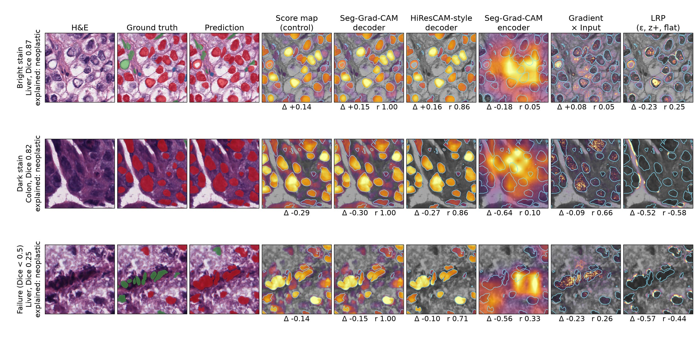
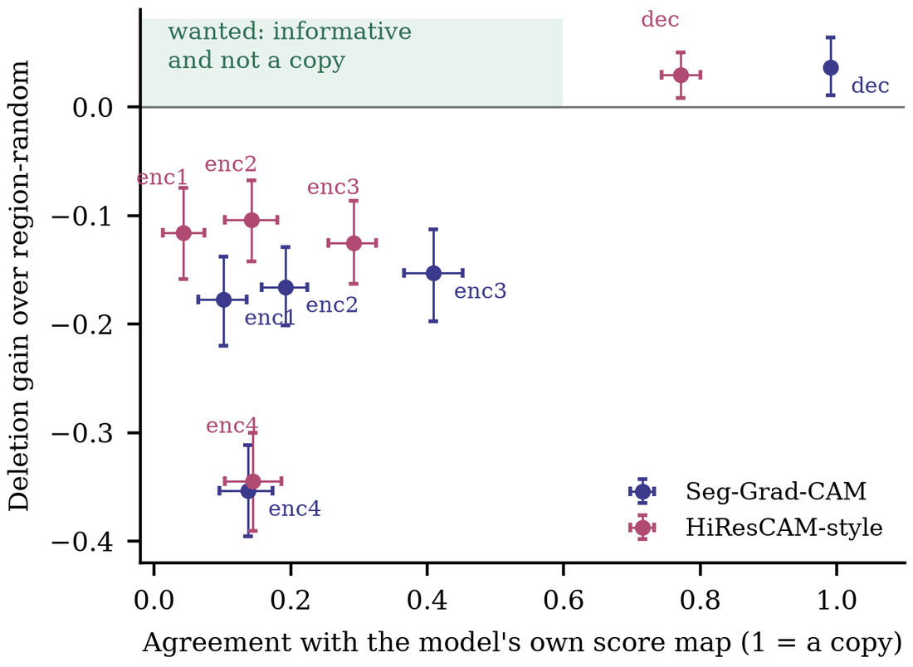

# Heatmaps That Redraw the Prediction

[](https://www.python.org/downloads/)
[](https://pytorch.org/)
[](checkpoints/)
[](https://devisri-b.github.io/MedSeg-Explainable-Equitable-Medical-Segmentation-Pipeline/)
[](LICENSE)

This repository contains the complete implementation, trained model checkpoints, per-image audit data, reproduction scripts, and interactive visual analytics explorer for the following work:

> **Heatmaps That Redraw the Prediction: A Control-Based Audit of Attribution Maps for Nucleus Segmentation in Histopathology**  
> Devi Sri Bandaru and Deepshikha Bhati (Kent State University, 2026)  

### Interactive Visual Analytics Explorer

**[Open the live explorer →](https://devisri-b.github.io/MedSeg-Explainable-Equitable-Medical-Segmentation-Pipeline/)**

A browser-based tool for testing the 's claims on real images. For each of 659 PanNuke tissue images you can see whether the heatmap shows anything beyond what the model already predicted, and whether it gives any warning when the segmentation fails.

- **Explore:** plot segmentation accuracy (Dice) against any explanation measure, filter by tissue and stain brightness, zoom and pan, and click any dot to see its heatmaps next to the ground truth and prediction.
- **Copy detector:** shows which heatmap methods merely redraw the model's own prediction score. Decoder Grad-CAM does this for 99% of images.
- **Failure triage:** simulates flagging bad segmentations (Dice < 0.5) from explanation measures, with a ranking-quality score (AUROC) and a chart of how many failures you catch for a given review budget.
- **Reliability atlas:** a tissue-by-measure grid showing where an explanation measure tracks segmentation quality and where it doesn't.

Studies B to D are available as per-image CSVs in [`results/`](results/README.md)
---



*Figure 1: Attribution maps from Model A (U-Net++ / ResNet-50) for a bright-stain tile (top), a dark-stain tile (middle), and a segmentation failure case (bottom, Dice < 0.5). For each map: **Δ** denotes deletion gain over random pixels inside the explained nucleus region (positive = informative; negative = worse than random chance), and **r** denotes Spearman rank correlation with the model's raw class-score control map (1.00 = identical copy). Cyan contours outline the explained nucleus region. Maps are clipped at their 99th percentile for display. Decoder Seg-Grad-CAM acts as a near-perfect copy of the prediction score ($r = 1.00$), including on the failure case where it highlights misclassified nuclei with high confidence and gives no sign that the segmentation is incorrect.*

---

## What We Ask

Attribution heatmaps are often read as "the bright pixels are why the model drew what it drew", but are rarely tested. We compare each map with a **gradient-free control** built from the network's own class-score map. If a gradient-based map ranks pixels no better than this control, it is copying the prediction. We audit six attribution configurations across 3,180 image-level evaluations (three architectures, four folds, PanNuke and external MoNuSeg), and ask whether the maps reflect the computation, whether their quality is uniform across tissue and stain, and whether they can warn of a failed segmentation.

---

## Experimental Setup: The Four Studies

We evaluate four distinct experimental studies to ensure findings are not quirks of an isolated model or split:

| Study | Model Architecture | Evaluation Cohort | Audited Images | Explained Class Mean Dice |
|:---:|:---|:---|:---:|:---:|
| **A** | **U-Net++ / ResNet-50** (Tuned main model) | PanNuke fold 3 (19 tissue types) | 659 | 0.72 |
| **B** | **FPN / ResNet-18** (Trained for 3 epochs) | PanNuke fold 1 (19 tissue types) | 1,333 | 0.59 |
| **C** | **Model A applied to external data** | MoNuSeg (external institutions) | 200 | 0.82 |
| **D** | **U-Net / ResNet-18** (Trained for 4 epochs) | PanNuke fold 2 (19 tissue types) | 988 | 0.61 |
| **Total** | | | **3,180** | |

*In Study C, because MoNuSeg lacks multi-class nucleus types, the five nucleus logits are merged via log-sum-exp into a single foreground score ([`medseg/explain/binary_fg.py`](medseg/explain/binary_fg.py)).*

### Evaluated Attribution Configurations

| Method Code | Description | Layer Target |
|:---|:---|:---|
| `cam@dec` | **Seg-Grad-CAM** | Final decoder block |
| `hires@dec` | **HiResCAM-style** (element-wise gradient $\times$ feature map, no spatial pooling) | Final decoder block |
| `cam@enc4` | **Seg-Grad-CAM** | Deepest encoder stage (Stage 4) |
| `hires@enc4` | **HiResCAM-style** | Deepest encoder stage (Stage 4) |
| `gxi` | **Gradient × Input** | Input pixel space |
| `lrp` | **Layer-wise Relevance Propagation** (Zennit; $\epsilon$ dense, $z^+$ conv, flat input layer) | Full model decomposition |
| `logit` | **Prediction Score Control** ($\text{ReLU}$ of target class logit; requires **no gradients**) | Output layer |

---

## Key Findings

1. **Decoder maps redraw the prediction.** Decoder Seg-Grad-CAM correlates 0.95 to 0.99 with the score-map control in every study (A: 0.991) and gains no more than the control.
2. **Looking deeper does not help.** Encoder-level maps and LRP rank pixels worse than random inside the explained region in all four studies (deletion gain −0.06 to −0.38), although they look localized.
3. **Stability masks a stain effect.** Decoder maps look more stable in dark-stained images (pooled p < 10⁻²⁰) while Dice does not differ. Part of this is copying; the effect survives adjustment in three of four studies.
4. **Failure detection depends on the model.** On the tuned model (A), explanation signals add nothing to predictive uncertainty (AUROC 0.872 → 0.862). On the weaker models (B, D) they help modestly (+0.034, +0.014).

Full tables with confidence intervals (deletion gain, failure detection, stain stability) are in [`docs/EXPLANATION_AUDIT.md`](docs/EXPLANATION_AUDIT.md#results) and the manuscript.

### Encoder Depth Sweep

<p align="center">
  
</p>

*Depth sweep on Model A (100 images, 95% bootstrap intervals): Every encoder stage ranks pixels worse than random chance ($\Delta < 0$). Only the decoder is above zero, and there the attribution map is a near-copy of the model's raw class-score map ($r \approx 0.99$). The shaded region indicates the quadrant a genuinely informative, non-copying attribution map would need to occupy.*

---

## Installation & Quickstart

*You do not need to install anything to browse the results: the [live explorer](https://devisri-b.github.io/MedSeg-Explainable-Equitable-Medical-Segmentation-Pipeline/) runs in the browser. Install only to re-run the audits.*

### Prerequisites
- Python 3.10 or newer
- Git with [Git LFS](https://git-lfs.com/) installed
- All experiments run seamlessly on CPU; a GPU (CUDA or Apple Silicon MPS) accelerates training and batch audits.

### Setup

```bash
# 1. Clone the repository
git clone https://github.com/Devisri-B/MedSeg-Explainable-Equitable-Medical-Segmentation-Pipeline.git
cd MedSeg-Explainable-Equitable-Medical-Segmentation-Pipeline

# 2. Pull the trained model checkpoints via Git LFS
git lfs install
git lfs pull

# 3. Create virtual environment and install package
python -m venv .venv
source .venv/bin/activate
pip install -e ".[full]"

# 4. Verify the test suite
pytest -q tests
```

---

## Datasets

| Dataset | Role in the Study | Acquisition |
|:---|:---|:---|
| **[PanNuke](https://arxiv.org/abs/2003.10778)** | Model training and Studies A, B, D (folds 1–3, 19 tissues, 5 nucleus classes) | `python scripts/download_data.py --root data/pannuke` |
| **[MoNuSeg](https://monuseg.grand-challenge.org/)** | Study C external generalization test (30 whole-slide tiles from multiple centers) | Auto-prepared on first `--dataset monuseg` execution |

*Both datasets are distributed under open non-commercial research licenses; please cite the respective authors.*

---

## Trained Model Checkpoints

Pre-trained weights are tracked in [`checkpoints/`](checkpoints/README.md) via Git LFS and verified by [`checkpoints/SHA256SUMS.txt`](checkpoints/SHA256SUMS.txt):

| Checkpoint File | Study | Architecture | Training Cohort → Evaluation Cohort | Size |
|:---|:---:|:---|:---|:---:|
| `study_A_unetpp_resnet50_fold3.pth` | **A, C** | U-Net++ / ResNet-50 | PanNuke folds 1+2 → fold 3 (C: MoNuSeg) | 196 MB |
| `study_B_fpn_resnet18_fold1.pth` | **B** | FPN / ResNet-18 | PanNuke folds 2+3 → fold 1 (3 epochs) | 52 MB |
| `study_D_unet_resnet18_fold2.pth` | **D** | U-Net / ResNet-18 | PanNuke folds 1+3 → fold 2 (4 epochs) | 57 MB |

Each checkpoint contains its full hyperparameter specification and state dictionary (`ckpt["config"]`, `ckpt["state_dict"]`). Load any model directly with `medseg.evaluate.load_run`.

---

## Reproducing the Experiments

### 1. Stage Model Checkpoints

```bash
mkdir -p outputs/pannuke_resnet50 outputs/pannuke_fpn_r18_fold1 outputs/pannuke_unet_r18_fold2
cp checkpoints/study_A_unetpp_resnet50_fold3.pth outputs/pannuke_resnet50/best_model.pth
cp checkpoints/study_B_fpn_resnet18_fold1.pth   outputs/pannuke_fpn_r18_fold1/best_model.pth
cp checkpoints/study_D_unet_resnet18_fold2.pth  outputs/pannuke_unet_r18_fold2/best_model.pth
```

### 2. Execute the Attribution Audits (Studies A – D)

```bash
# Study A: U-Net++ / ResNet-50 on PanNuke fold 3 (659 images)
python -m medseg.explain.xai_audit --run outputs/pannuke_resnet50 --fold 3 --per-tissue 34 --lrp

# Study B: FPN / ResNet-18 on PanNuke fold 1 (1,333 images)
python -m medseg.explain.xai_audit --run outputs/pannuke_fpn_r18_fold1 --fold 1 --per-tissue 100 --lrp

# Study C: Model A evaluated on MoNuSeg (200 images, foreground log-sum-exp)
python -m medseg.explain.xai_audit --run outputs/pannuke_resnet50 --dataset monuseg --per-tissue 25 --lrp --out-name rows_monuseg.csv

# Study D: U-Net / ResNet-18 on PanNuke fold 2 (988 images)
python -m medseg.explain.xai_audit --run outputs/pannuke_unet_r18_fold2 --fold 2 --per-tissue 60 --lrp
```

### 3. Additional Experimental Checks

```bash
# Parameter randomization sanity check (40 images)
python -m medseg.explain.xai_sanity --run outputs/pannuke_resnet50 --n 40

# Encoder depth sweep across stages 1 to 4 and decoder (100 images)
python -m medseg.explain.xai_depth_sweep --run outputs/pannuke_resnet50 --n 100

# LRP rule ablation across eps_plus_flat, eps_plus, and eps_gamma_box (60 images)
python -m medseg.explain.xai_lrp_ablation --run outputs/pannuke_resnet50 --n 60
```

### 4. Regenerate Tables, Figures, and Result Files

```bash
# Generate statistical tables, failure detection models, and bootstrap intervals
python -m medseg.explain.xai_analysis --run outputs/pannuke_resnet50

# Replicate side-by-side multi-study synthesis (replication.json, replication_methods.csv)
python -m medseg.explain.xai_replication --out outputs/replication --studies A,B,C,D

# Regenerate  Figure 1 (attribution panels across bright, dark, and failure cases)
python -m medseg.viz.paper_figures heatmaps --indices 2199,841,2165 --out assets/heatmap_audit_examples.jpg
```

---

## Pre-computed Results in this Repository

Every single measured data point is saved under [`results/`](results/README.md) so the complete analysis can be verified instantly without retraining or re-running inference:

- **Per-Image Rows:** One row per audited tile with localization, deletion curves, stability, and correlation scores (`rows.csv`, `rows_lrp.csv`, `rows_dark.csv`, `rows_monuseg.csv`).
- **Statistical Summaries:** Per-tissue and per-stain metrics in `results/pannuke_resnet50/xai_audit/analysis/`.
- **Cross-Study Replication:** Multi-study synthesis in `results/replication/replication.json`.
- **Interactive Explorer:** the [live explorer](https://devisri-b.github.io/MedSeg-Explainable-Equitable-Medical-Segmentation-Pipeline/) is the same page as the standalone HTML file `results/pannuke_resnet50/xai_audit/explorer.html`, which also opens offline.

---

## Code Overview

The audit is built on a segmentation pipeline that is included so the studies can be reproduced end to end:

| Module | Implementation | Description |
|:---|:---|:---|
| **Attribution and audit** | [`medseg/explain/`](medseg/explain) | Seg-Grad-CAM, HiResCAM-style, Gradient × Input, LRP, the score-map control, deletion and stability metrics, analysis, depth sweep, LRP ablation, and cross-study replication |
| **Segmentation models** | [`medseg/models/`](medseg/models) | U-Net++, FPN, U-Net with ResNet encoders and a MiniUNet fallback |
| **Training** | [`medseg/losses.py`](medseg/losses.py), [`medseg/train.py`](medseg/train.py) | Combined Focal-Tversky loss, square-root class re-weighting, HED stain augmentation, test-time augmentation |
| **Evaluation** | [`medseg/metrics.py`](medseg/metrics.py), [`medseg/evaluate.py`](medseg/evaluate.py) | Per-class Dice and IoU, confusion matrices |
| **Subgroup disparity** | [`medseg/fairness/`](medseg/fairness) | Tissue-level and stain-level disparity used in the subgroup analysis |
| **Data** | [`medseg/data/`](medseg/data) | PanNuke and MoNuSeg loaders |
| **Figures and explorer** | [`medseg/viz/`](medseg/viz) | Interactive explorer builder and figure scripts |

---

## Repository Structure

```
├── assets/                     # Figures
├── checkpoints/                # Trained model weights for Studies A, B, D (Git LFS)
│   ├── SHA256SUMS.txt          # Cryptographic checksums
│   └── README.md               # Checkpoint descriptions and usage
├── configs/                    # Reproducible YAML training configurations
├── docs/
│   └── EXPLANATION_AUDIT.md    # Detailed audit protocols, equations, and tables
├── medseg/                     # Core Python package
│   ├── data/                   # PanNuke and MoNuSeg loaders and HED augmentation
│   ├── explain/                # Attribution methods, LRP, audit metrics, analysis
│   ├── fairness/               # Subgroup disparity
│   ├── models/                 # Model builders and wrappers
│   ├── metrics.py              # Segmentation evaluation metrics
│   └── viz/                    # Interactive explorer builder and figure scripts
├── results/                    # Per-image CSV logs, summaries, and explorer.html
├── scripts/                    # Data download helper
├── tests/                      # Automated unit and integration tests
├── pyproject.toml              # Build specifications and dependencies
├── requirements.txt            # Pinned environment requirements
└── LICENSE                     # MIT License
```

---

## Scientific Scope & Limitations

The study has these limits:
1. **Histopathology Modality:** Experiments evaluate nuclear instance/semantic segmentation in H&E-stained tiles from PanNuke and MoNuSeg. Findings should not be extrapolated to whole-slide multi-organ CT or MRI without explicit testing.
2. **Model Diversity:** Models B and D were deliberately trained for 3 and 4 epochs to act as audit subjects of differing capability (foreground Dice ~0.50); findings on them characterize weaker models rather than tuned segmenters.
3. **LRP Relevance Conservation:** Under our segmentation setup, total input relevance varies between $-14\%$ and $+16\%$ of the explained logit score. LRP maps should be interpreted as localized sensitivity indicators rather than strict mathematical conservation decompositions.
4. **Deletion Protocols:** Pixel deletion substitutes uninformative ImageNet mean color into masked locations. While standard in XAI literature, synthetic pixel filling alters image statistics; this motivates our comparison against region-restricted random baselines.
5. **Observational Staining Proxy:** Stain brightness serves as an observational proxy for laboratory, scanner, and protocol differences, rather than a direct physical measurement.
6. **Sensitivity vs. Causation:** Saliency maps quantify mathematical model sensitivity, not histological causation in tissue pathology.

---

## Citation

If you use this codebase, checkpoints, or findings in your research, please cite:

```bibtex
@article{bandaru2026heatmaps,
  title   = {Heatmaps That Redraw the Prediction: A Control-Based Audit of Attribution Maps for Nucleus Segmentation in Histopathology},
  author  = {Bandaru, Devi Sri and Bhati, Deepshikha},
  journal = {arXiv preprint},
  year    = {2026},
  url     = {https://github.com/Devisri-B/MedSeg-Explainable-Equitable-Medical-Segmentation-Pipeline}
}
```

Please also cite the foundational benchmark datasets and tools:
- **PanNuke:** Gamper et al., *PanNuke: An Open Pan-Cancer Histology Dataset for Nuclei Instance Segmentation and Classification*, CMPB 2019 / arXiv 2020.
- **MoNuSeg:** Kumar et al., *A Dataset and a Technique for Generalized Nuclear Segmentation for Computational Pathology*, IEEE TMI 2017.
- **Zennit:** Anders et al., *Software for Dataset-wide XAI: From Local Explanations to Global Insights with Zennit, Corelay, and Virelay*, PLoS ONE 2026.

---

## License

This project is licensed under the [MIT License](LICENSE). The underlying PanNuke and MoNuSeg datasets maintain their respective non-commercial academic research licenses.
